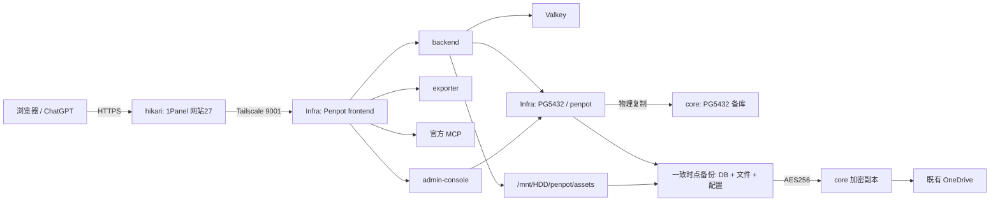

# Penpot 长期接续

任务 [#65](https://github.com/StLixx/Xenica/issues/65) 属于 [#54](https://github.com/StLixx/Xenica/issues/54) 的 v0.2.5 开发脚手架搭建目标。2026-10-14 发布后追加；不属于已发布 Tag 的原源码树。决定见 [ADR 0017](../adr/0017-penpot-scaffolding.md)，设备及非敏感参数见 [清单](penpot-inventory.json)，记录方式见 [考证索引](penpot-recording.md)。设备数据是当日快照，操作前重新核验。

## 固定入口与职责

| 入口 / 设备 | 用途与边界 |
| --- | --- |
| `https://penpot.truebigsand.top` | 自用设计工作区；公开注册关闭，原账号邮箱登录 |
| `https://penpot.truebigsand.top/admin-console` | 公网原生管理入口，沿用账号与组织权限；组织尚未创建，许可未激活 |
| ChatGPT 插件「Penpot（自建）」 | 仅本人使用，官方 MCP 四个工具；设计文件须连接 MCP，标签页挂起时唤醒重试 |
| hikari / `100.125.180.76` | 1Panel 网站 27，TLS、反代、WebSocket；Cloudflare A 记录指向 `139.224.197.51`，仅 DNS |
| Infra / `100.100.1.202` | 六个应用组件、共享 PG 主库、文件、配套备份、监控、重型测试 |
| core / `100.100.1.103` | 共享 PG 备库、加密备份副本、现有 OneDrive 同步与云端恢复下载 |
| Windows / `C:\dev\Xenica` | 编辑、SSH、浏览器验证；不承载 Docker、PG 或大型构建 |

当日设备概览（可用量会变化，精确字节见清单）：

| 设备 | CPU / 系统可见内存 | 磁盘与系统 |
| --- | --- | --- |
| Infra | 32 vCPU，EPYC 7R32 型号标识，约 15.1 GiB | Ubuntu 26.04.1 / VMware；HDD ext4 约 2.6 TiB，总可用约 2.35 TiB；根卷可用约 42.1 GiB |
| core | 16 逻辑 CPU，Xeon E5-2698 v3，约 15.6 GiB | Ubuntu 24.04.4；根卷可用约 25.0 GiB，备份副本使用该卷 |
| hikari | 2 逻辑 CPU，Xeon Platinum，约 1.83 GiB | Debian 13.1；根卷约 39.0 GiB，主要承载入口 |
| Windows | Ryzen 5 5500GT，12 逻辑 CPU，系统可见约 31.3 GiB | Windows 11 Pro，10.0.26200；ASUS 主板标识，编辑与验证用途 |



## 决定与实际状态

- 预计两人自用；只创建首个账号，显示名称为 `Lixx`。同学邮箱仅预留。具体邮箱与验证密码在服务器私有初始化文件，用户已自行改密；不能沿用聊天中的旧密码。
- 用户取消 Google 登录，SMTP 暂不配置，邮件邀请和密码找回不可用。账号增设与改密使用原生流程；修改后同步私有恢复验证凭据。
- 用户逐项批准 MCP、Webhooks、个人 API Token、公网管理入口；随后批准 Agent 创建个人 ChatGPT 插件和无限期 MCP 密钥。普通 API 测试 Token 已撤销，测试 Webhook、临时接收路由及测试 MCP 密钥已清理。
- MCP 为官方 2.18.3 多用户组件，远程模式、REPL 关闭、不挂载主机文件；公开工具清单可扫描，画布操作须通过有效密钥与活动文件连接。不要把工具扫描成功当作画布验证。
- 同账号重新生成 MCP 密钥会撤销此前 MCP 密钥；现有 ChatGPT 配置须同步更新，不能把生成新密钥当作普通连接检查。
- 个人 API Token 与团队 Webhooks 原生入口已开放；尚无生产 Xenica 接收地址，也未完成 Xenica 内嵌或同步。
- 管理控制台开关带出上游 Enterprise 推广；样式仅隐藏推广横幅、其他套餐及升级菜单，保留当前订阅、控制台、组织权限和到期提醒。没有购买或绕过 Enterprise 许可。
- 原生对象存储为文件系统。图片下载使用专用双栈网络与 JVM IPv6 优先，保留 IPv4；从固定镜像提取的 MPL `app.media` 启动覆盖仅添加描述性 User-Agent。大小、类型、重定向、SSRF、TLS 和清洗检查保留。

## 权威文件与私有依赖

| 位置 | 内容 / 责任 |
| --- | --- |
| `deploy/penpot/compose.yaml`、`.env.example` | 六组件、资源限额、专用双栈网络、公开入口与固定镜像变量 |
| `deploy/penpot/runtime-patches/` | 同版本上游媒体源码、加载入口及原启动脚本覆盖；保留 MPL 声明 |
| `deploy/penpot/selfhost.css`、`frontend-custom.conf` | 推广展示覆盖及样式注入；升级复核选择器 |
| `deploy/penpot/hikari-mcp-location.conf` | 公网 MCP 代理模板，关闭含密钥 URL 的请求 / 错误日志及响应缓冲 |
| `deploy/penpot/{backup,restore,routing,health}.py`、`test_*.py` | 配套备份、隔离恢复、主库路由预检、首页初始化监控和负向回归 |
| Infra `/opt/stacks/penpot/` | 运行 Compose、固定镜像 `.env`、样式与媒体覆盖；`.env` 不能提交 |
| Infra `/opt/penpot-ops/` | 已部署运维脚本与测试；`source.json` 记录与源码的 LF 规范化核对 |
| Infra `/etc/penpot-ops/{backend,exporter,admin-console}.env` | 稳定服务密钥、数据库权限与私有配置；root 读取，随配置加密备份 |
| Infra `/etc/penpot-ops/bootstrap.json` | 原账号、预留邮箱和当前私有验证凭据；隔离登录验证依赖，未纳入配套配置归档 |
| Infra `/etc/penpot-ops/panel.key` | 既有 1Panel API 密钥；不能提交、打印或放入 URL |
| Infra `/var/lib/penpot-ops/dnsaccounts.json` | 既有 DNS 账户私有缓存，含 Cloudflare 凭据；由私有 `access.py` 使用 |
| Infra `/var/lib/penpot-ops/chatgpt-mcp-connection.json` | 无限期个人 MCP 连接密钥及完整 URL；密钥不得出现在公开截图、日志或 Git |
| Infra `/var/lib/penpot-ops/images.json`、`source.json`、`*.json` 报告 | 镜像、源码及原始验证证据；先按白名单脱敏再写仓库 |
| `/etc/pg-ops/backup.key`、core 的 rclone / SSH 配置 | 解密与云端下载依赖，单独私有保管；公开仓库只记录位置和验证条件 |

core 的 rclone 配置实际位于 `/root/.config/rclone/rclone.conf`；其中云端认证数据不公开。配置表与实际文件权限一并核对，恢复前确保密钥和原验证凭据另有可信私有副本。

hikari 的配置通过既有 1Panel API 编辑：`/websites/27/config/openresty` 读取、`/websites/nginx/update` 校验并重载。证书使用既有自动续期通配符配置，重验时只读取证书公开元数据，不能导出私钥。Cloudflare DNS 修改复用既有账户。

## 运行与恢复

在 Infra 执行；先确认真实主机、目录、当前镜像和业务权限。以下入口均使用服务器私有配置，命令不带密码。

```sh
cd /opt/stacks/penpot
docker compose config --quiet
docker compose ps
curl --fail http://100.100.1.202:9017/health
python3 -S /opt/penpot-ops/routing.py 100.100.1.202 --check
python3 -S /opt/penpot-ops/backup.py
python3 -S /opt/penpot-ops/restore.py
```

查看日志先限制时间与组件，公开记录前脱敏。数据库目标变化时，先用业务角色验证 `pg_is_in_recovery() = false`、数据库与权限，再一起更新后端和管理组件；只看端口连通、`pg_isready` 或容器 healthy 不够。`routing.py` 只接受已登记主机，当前两端 PG 均为 5432，实际备库拒绝验证通过。端口变更需同步私有 URI；脚本不会猜测新端口。

- 文件：`/mnt/HDD/penpot/assets`；明文配套备份：`/mnt/HDD/penpot/backups/<stamp>`；Infra 加密副本：`/mnt/HDD/pg-ops/encrypted/penpot-assets/base/<stamp>`。
- 每日 `03:00 Asia/Shanghai`，随机延迟不超过两分钟；暂停 backend、exporter、admin-console 写入，复制数据库、文件与恢复配置后恢复组件。失败也尝试恢复所有已暂停组件。
- 备份目录 `<stamp>` 使用 UTC，末尾 `Z`；计划时间与人读日期使用 Asia/Shanghai。数据库当前编码 UTF8、排序 / 字符类型 `en_US.utf8`、时区 Asia/Shanghai，扩展为 `plpgsql` 和 `uuid-ossp`，详见清单。
- AES256 加密后经 SSH / rsync 到 core，再到 `drive02:PG-operations-v1/penpot-assets/base/<stamp>`。保留最近七个完整集合；云端确认保留副本后才清理。手动备份也计入保留集合。
- 配置归档包括三个组件环境文件、Compose / 镜像 `.env`、样式和运行覆盖。MCP Token 与用户资料在原生数据库；个人连接 JSON 是私有便利副本。
- `restore.py` 从实际 OneDrive 下载、解密、核验清单 / 文件摘要，在无外部出口、无公开端口的 PG18、Valkey、backend、admin-console 临时实例恢复，验证数量、原账号登录及设计读取，最后清理临时容器 / 网络。它不替换生产数据，不执行生产切换。
- 当前演练依赖现有备份密钥、core SSH / rclone、`bootstrap.json`、`images.json` 与 PG 镜像配置。新机接管需单独恢复这些依赖；跨版本先核对归档 `.env` 与固定镜像。尚未实测两台服务器同时丢失后的整机恢复。
- PG 持续 WAL 与文件每日备份粒度不同；整套 Penpot 恢复使用配套一致时点，不宣称文件分钟级 PITR。

## 故障与验证边界

| 现象 | 已知依据与处理 |
| --- | --- |
| 首页与控制台显示内部错误 | 用户 `report.txt` 指向 `get-profile` 500。2026-10-14 PG 容器重建为 5432，旧 5433 URI 连接拒绝；验证主库后修正两个组件。两种浏览器入口及原账号实测通过。 |
| 健康状态错误地显示正常 | 匿名项目请求在查询 DB 前即返回 401。新增首页 `get-profile` 探针，500 / 超时必须异常；回归先失败后通过。 |
| Wikimedia 图片超时 / 403 | IPv4 路径超时，IPv6 可达；默认 Java 请求标识被拒绝，描述性本站标识可下载。原生 PNG 120×110、JPEG 500×477 导入通过。 |
| SVG / 其他来源图片 | 测试 SVG 仍触发原生 XML 解析错误。用户截图中另一来源的 I/O 错误缺少原始 URL，未登记为独立复测通过；不保证任意公网 URL 可达。 |
| MCP 无法操作 | 检查文件是否连接、标签页是否挂起、密钥是否有效；无效密钥 / 未连接拒绝已实测。不要重建账号或删除文件来解决连接问题。 |
| Edge 曾白屏 | 早期有防指纹脚本冲突线索，用户选择自行处理；未修改浏览器保护。后续本次服务端故障在两种浏览器均复现并修复。 |
| 手机编辑器不完整 | 390px 原版界面已观察并披露；使用桌面浏览器，未登记移动编辑通过。 |

初始验证文件后来被用户继续设计，受保护 ID 在清单中；不能按「MCP verification」名称清理。只有新建独立图片测试文件通过原生回收站软删除。截图、合并或临时预览结束不删除用户设计。

监控检查六个组件、首页、匿名权限、实际 profile 初始化、备份新鲜度和 HDD 容量，接入既有状态变化监控；当前阈值和响应规则以 `health.py` 为准。最新恢复基线是 `20261014T144654Z`，15 个资源，原账号及设计读取通过，35.4 秒；这是当时报告，不是持续状态保证。
